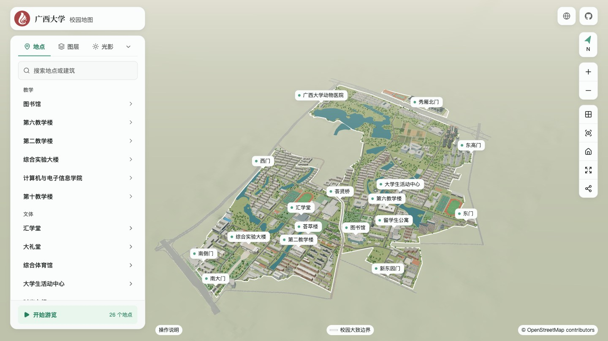
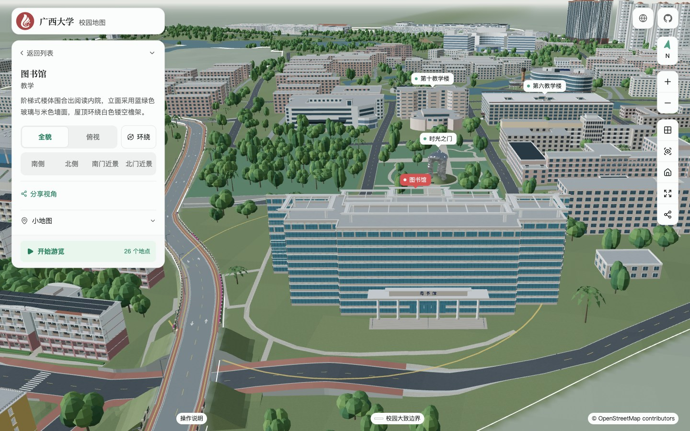
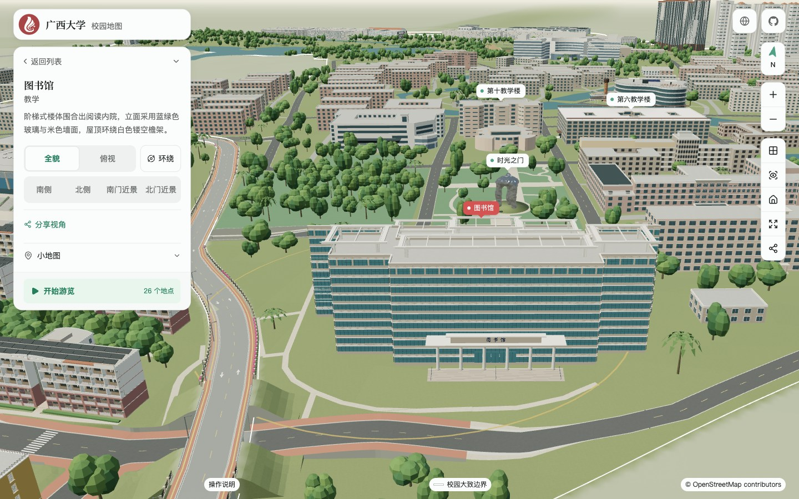
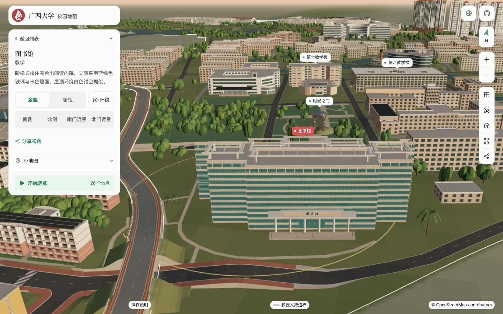
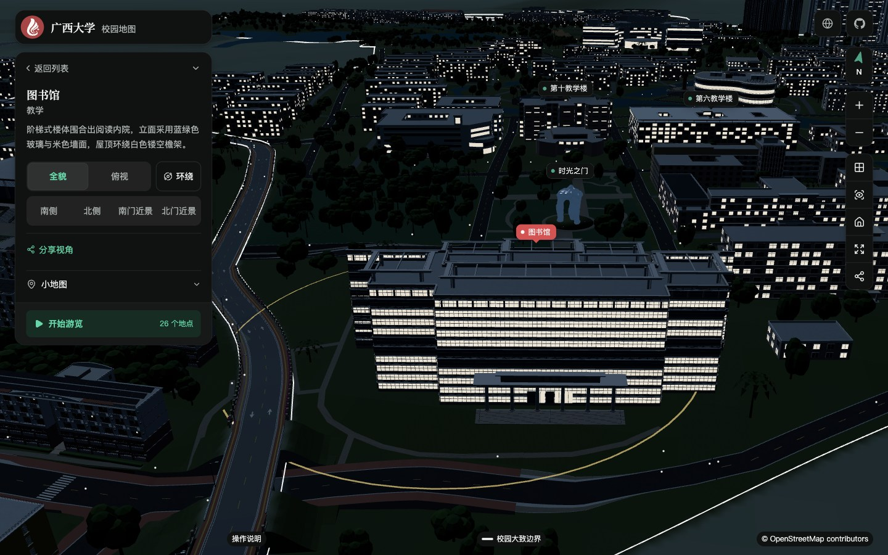
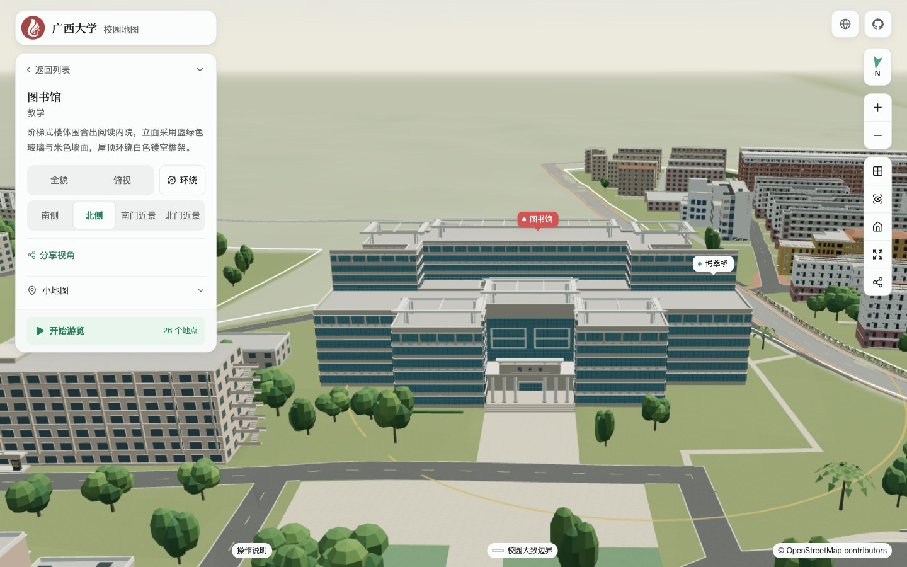
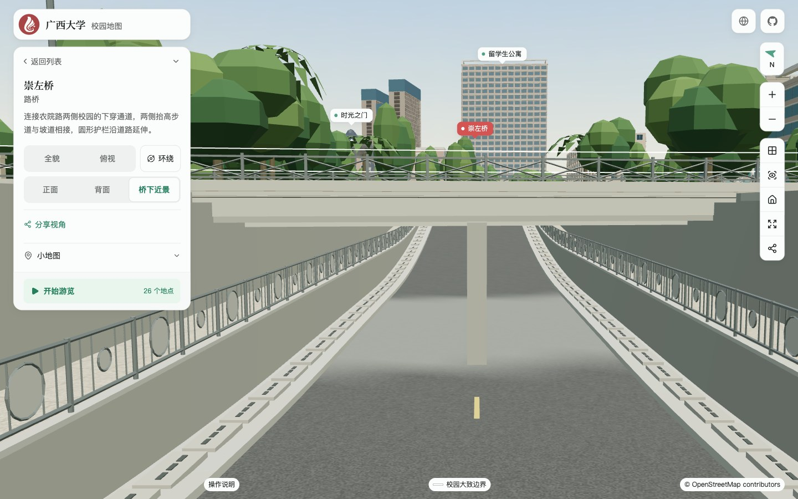
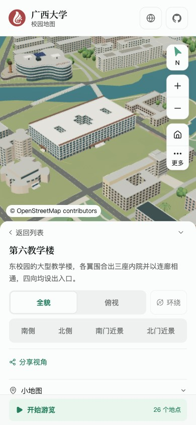
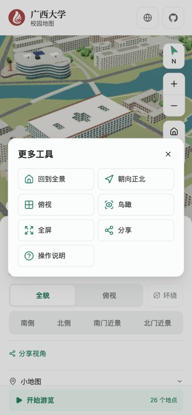
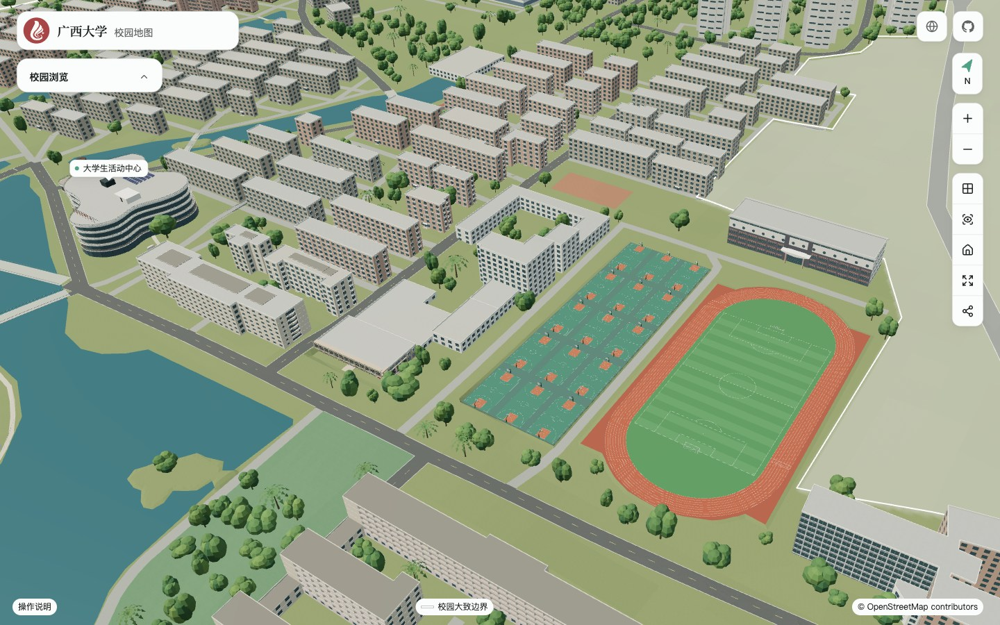

<h1 align="center">Guangxi University Campus Map</h1>

<p align="center"><a href="README.md">简体中文</a> · <strong>English</strong></p>

An interactive 3D map of Guangxi University's main campus on Daxue East Road. Geographic footprints come from OpenStreetMap, key buildings and landmarks are modeled in Blender from public sources, and the web app runs on Three.js and React.

**[Explore online](https://wcqqq1214.github.io/gxu-campus-3d/)**



## Features

- Search campus landmarks, college buildings, dining halls, and dormitories by Chinese or English name, abbreviation, or school; switch camera viewpoints or take a guided tour.
- Switch between Morning, Day, Evening, and Night lighting, toggle map layers, and adjust graphics quality.
- Share a link to your current view or export a PNG screenshot with OpenStreetMap attribution.
- Works with mouse, touch, and keyboard navigation, and respects system reduced-motion settings.

<details>
<summary>More screenshots: lighting, close-ups, and mobile</summary>

| Morning | Day |
| --- | --- |
|  |  |
| Evening | Night |
|  |  |
| North side of the library | Road beneath Chongzuo Bridge |
|  |  |
| Mobile place details | Mobile tools |
|  |  |



</details>

> Overview captured on 2026-10-27; the rest on 2026-10-12 from local `dev` static builds (with simulated mobile viewports), so details may differ slightly from the live site.

## Run locally

This project uses Node.js 24 (pinned in [.nvmrc](.nvmrc) and matched in CI; with nvm, run `nvm install && nvm use`). No map API key or backend service is needed:

```sh
git clone --branch dev https://github.com/wcqqq1214/gxu-campus-3d.git
cd gxu-campus-3d
npm ci
npm run dev
```

Open the Local URL printed in your terminal. To generate and preview a static build locally:

```sh
npm run build:pages   # Build static assets into out/
npm run preview       # Serve at http://127.0.0.1:4300/gxu-campus-3d/
```

### Checks and tests

- **Frontend checks**: `npm run check` runs TypeScript type checking, oxlint, and JS/TS unit tests. You can also run `npm run typecheck:fast` for fast type checking with tsrs (used by CI in the `frontend` job).
- **Python checks and tests**: Python is pinned to 3.12 in [.python-version](.python-version). After installing the dev dependencies, run `npm run lint:python` for Ruff checks, `npm run format:python` to format, and `npm run test:data` for data and contract tests.
- **Browser regressions**: Install Chromium with `npx playwright install chromium`, then run `npm run test:browser` to verify menus, camera controls, and the bilingual interface (set `BROWSER_TRACE=1` to record DOM/network traces).

Pushes to `dev` trigger CI jobs in parallel by changed paths across frontend, Python (`npm run test:data`), Blender geometry regressions (`npm run test:geometry`), and browser regressions; pushes or PRs to `main` run the full suite, and only pushes to `main` deploy. See [model structure, tests, and rebuilding](docs/MODELING.md) for full setup details.

## Data and documentation

The model covers the east, west, and north campus areas. It is not based on an on-site survey; some heights, facades, and layouts are estimated from public sources. Documentation is in Chinese:

- [Data sources and accuracy](docs/DATA.md)
- [Model structure, tests, and rebuilding](docs/MODELING.md) (Blender source files are not distributed; the website runs without them)
- [Interface and interactions](docs/DESIGN.md)

Original code, documentation, models, materials, and renders are [MIT-licensed](LICENSE). OpenStreetMap geographic databases and derived databases are licensed under ODbL with attribution to **© OpenStreetMap contributors**. See [third-party notices](licenses/THIRD_PARTY.md) for other assets. Reference photos and videos are not distributed.
