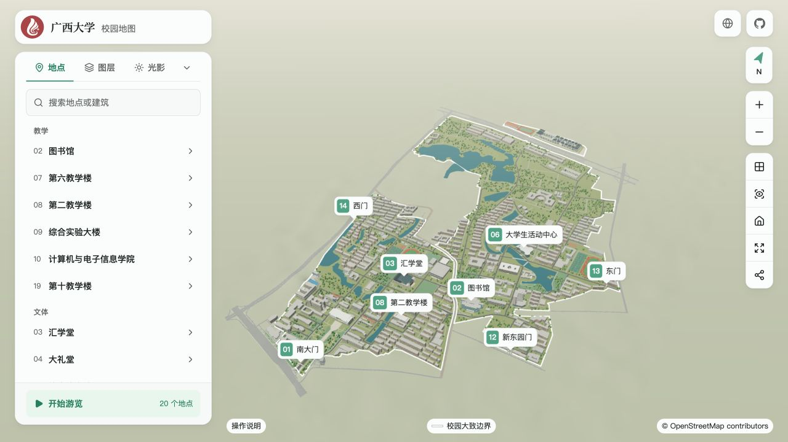
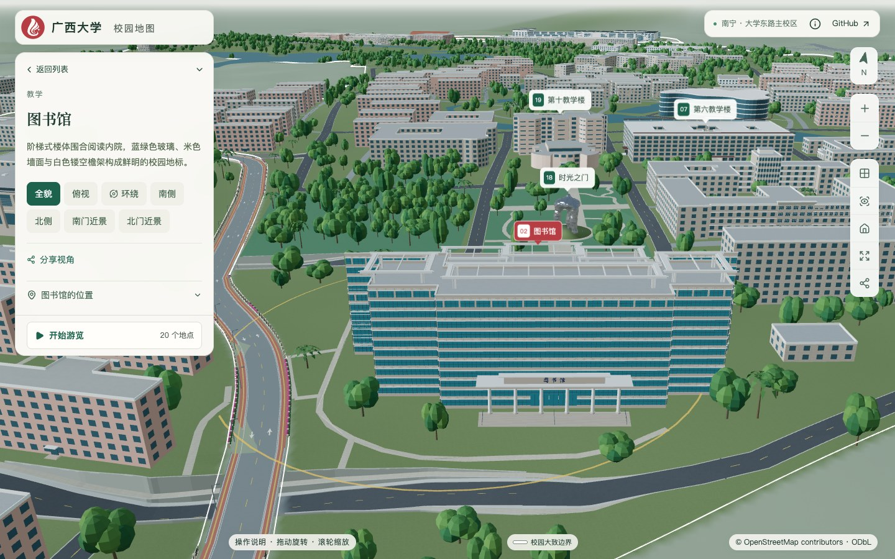
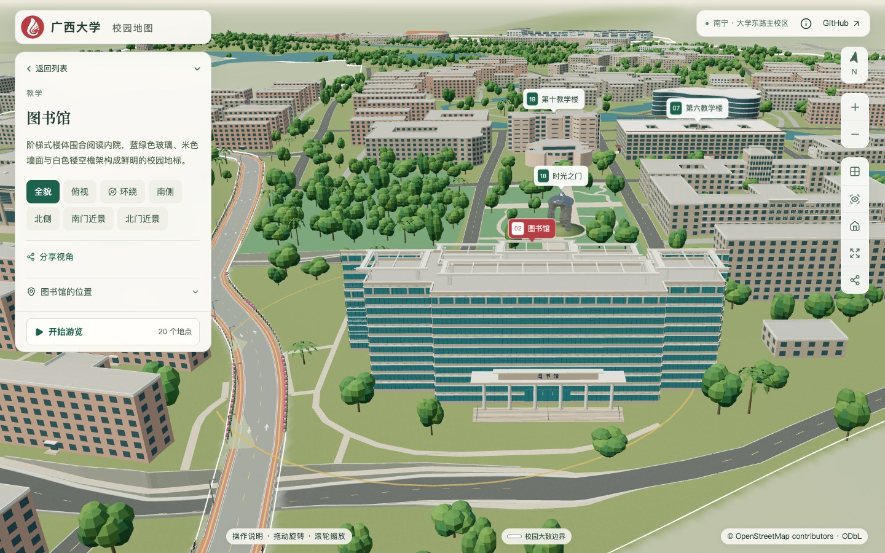
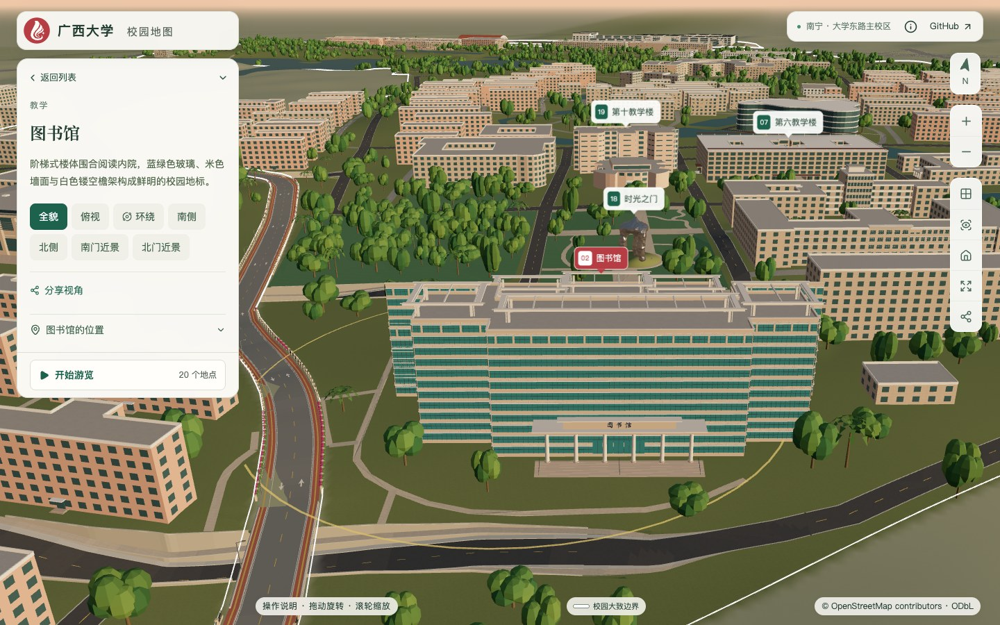
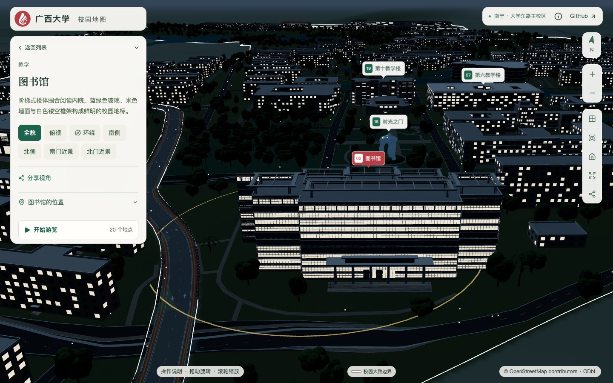
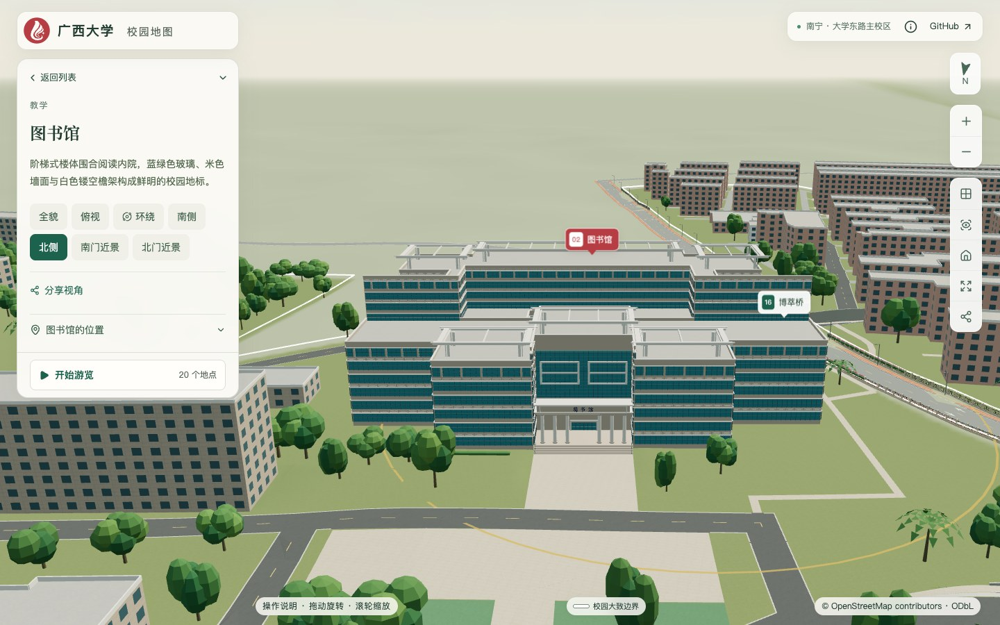
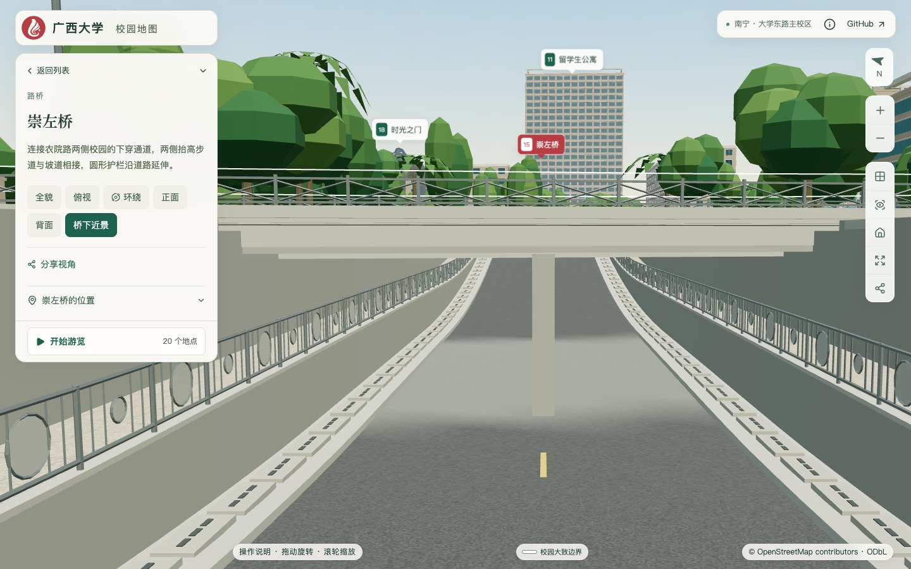
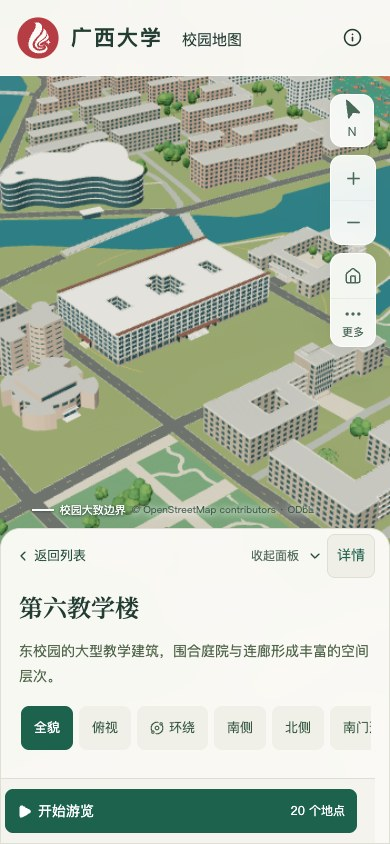
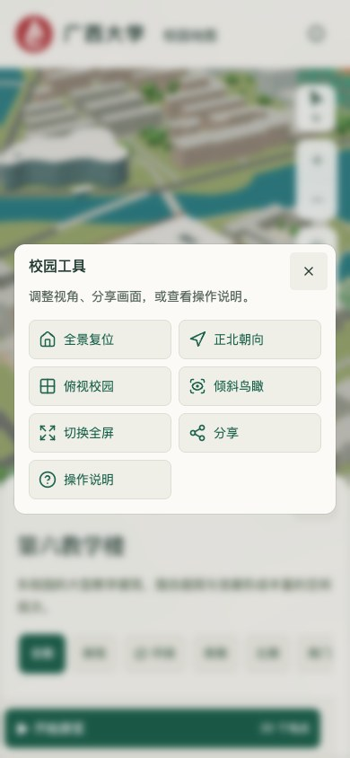
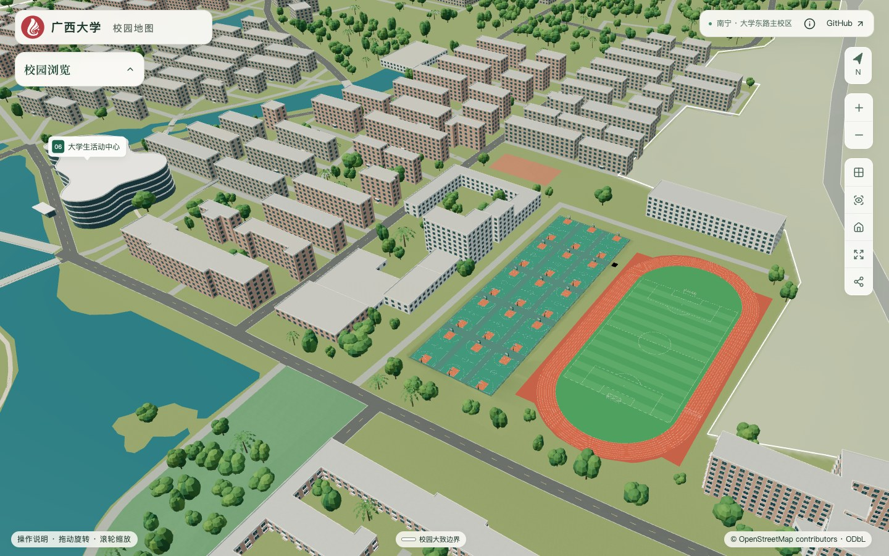

<h1 align="center">广西大学 校园地图</h1>

<p align="center"><strong>简体中文</strong> · <a href="README.en.md">English</a></p>

广西大学大学东路主校区的交互式三维地图，使用 Three.js、Blender 与 React，基于 OpenStreetMap 和公开资料建模。

**[在线游览](https://wcqqq1214.github.io/gxu-campus-3d/)**



## 功能

- 搜索校园地点和建筑，切换观察视角，跟随校园游览路线。
- 晨光、日间、黄昏、夜景四种光影，可调整图层与画质。
- 分享当前视角，或导出带 OpenStreetMap 署名的 PNG。
- 适配手机与键盘操作，支持系统“减少动态效果”偏好。

<details>
<summary>更多截图：光影、近景与手机界面</summary>

| 晨光 | 日间 |
| --- | --- |
|  |  |
| 黄昏 | 夜景 |
|  |  |
| 图书馆北侧 | 崇左桥下穿道路 |
|  |  |
| 手机地点详情 | 手机工具菜单 |
|  |  |



</details>

全景截图：2026-10-27；其余截图：2026-10-12。均来自本地 `dev` 静态构建，手机为浏览器模拟，可能与在线站点不同。

## 本地运行

使用 Node.js 24，无需地图密钥或后端服务。

```sh
git clone --branch dev https://github.com/wcqqq1214/gxu-campus-3d.git
cd gxu-campus-3d
npm ci
npm run dev
```

打开终端输出的 Local 地址。静态构建运行 `npm run build:pages`，产物位于 `out/`；运行 `npm run preview` 后访问 <http://127.0.0.1:4300/gxu-campus-3d/>。

## 数据与文档

覆盖东、西、北校园。未经实地测绘，部分高度、立面和设施布局为估算。

- [数据来源与精度](docs/DATA.md)
- [模型结构、测试与重建](docs/MODELING.md)（Blender 源文件未分发，运行网页无需该文件）
- [界面与交互](docs/DESIGN.md)

原创代码、文档、模型、材质及渲染图采用 [MIT](LICENSE)；OpenStreetMap 地理数据库及衍生数据采用 ODbL，署名 **© OpenStreetMap contributors**。其他资源见 [第三方说明](licenses/THIRD_PARTY.md)。参考照片与视频不随仓库分发。
