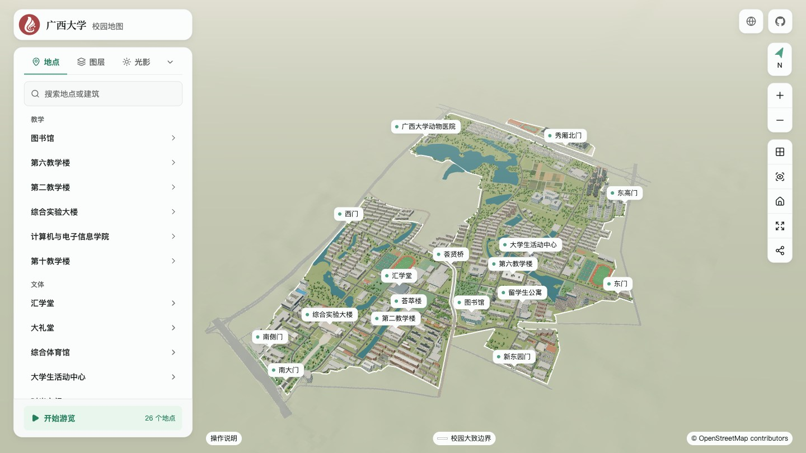
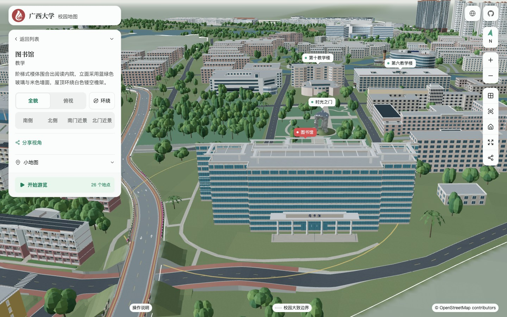
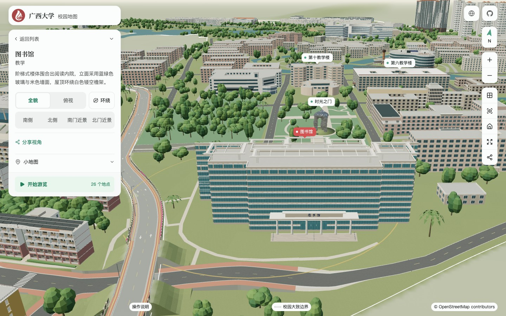
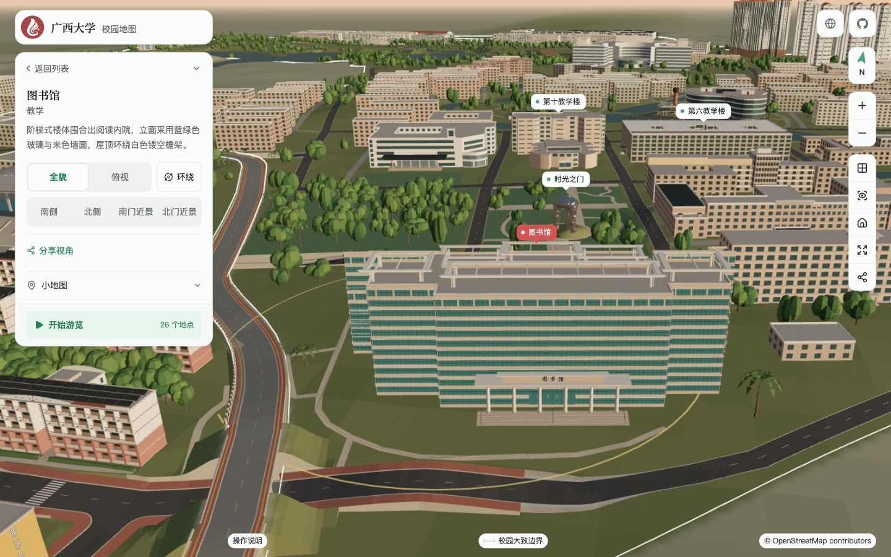
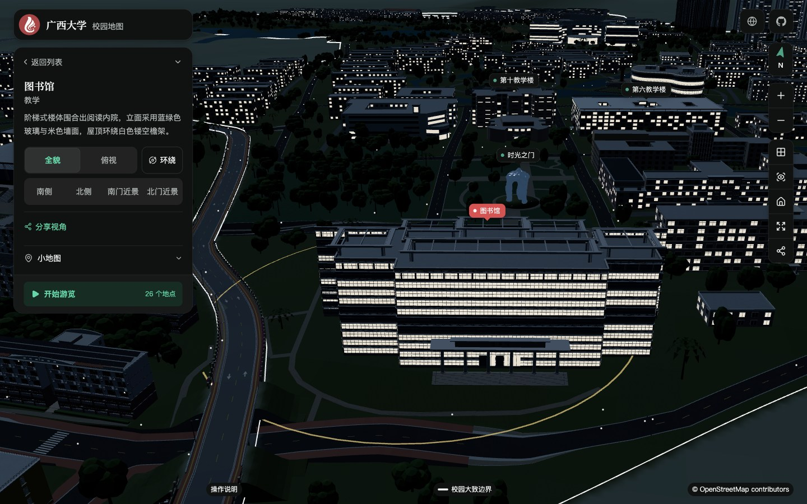
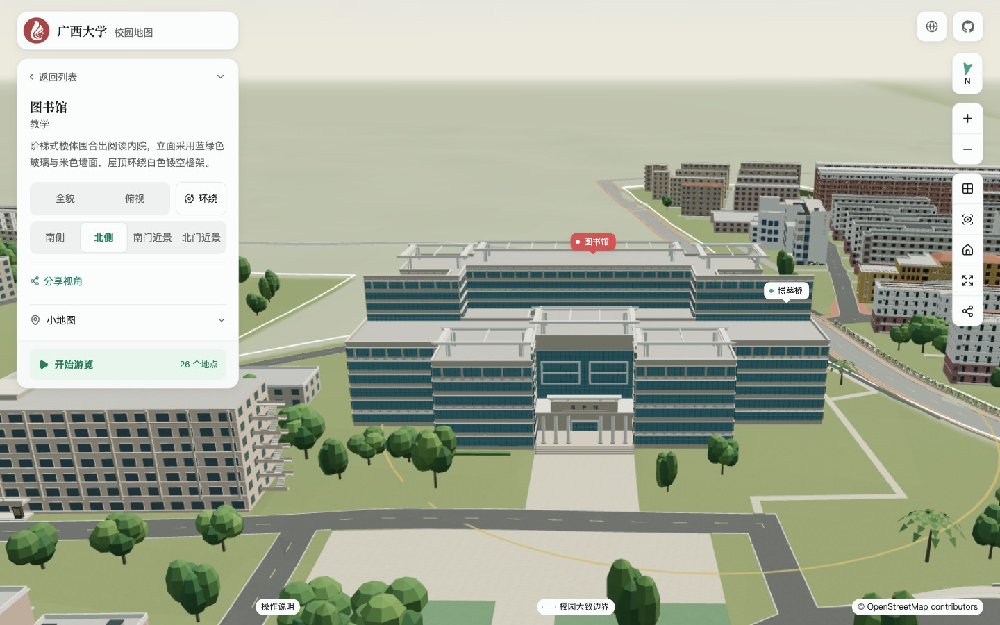
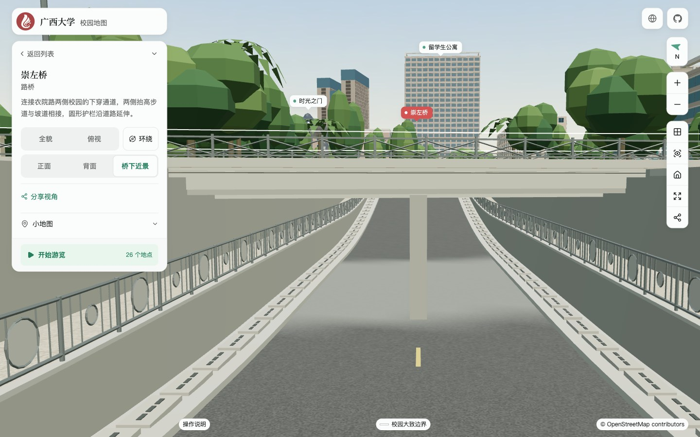
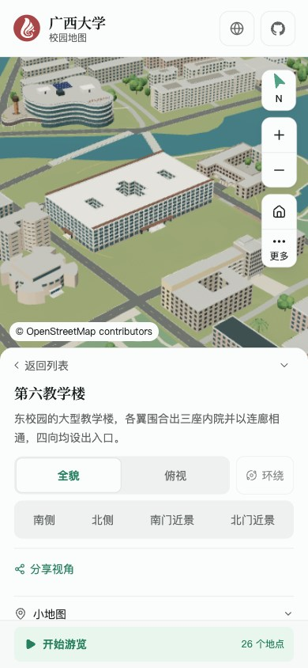
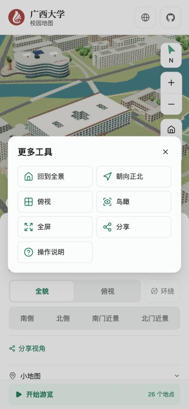
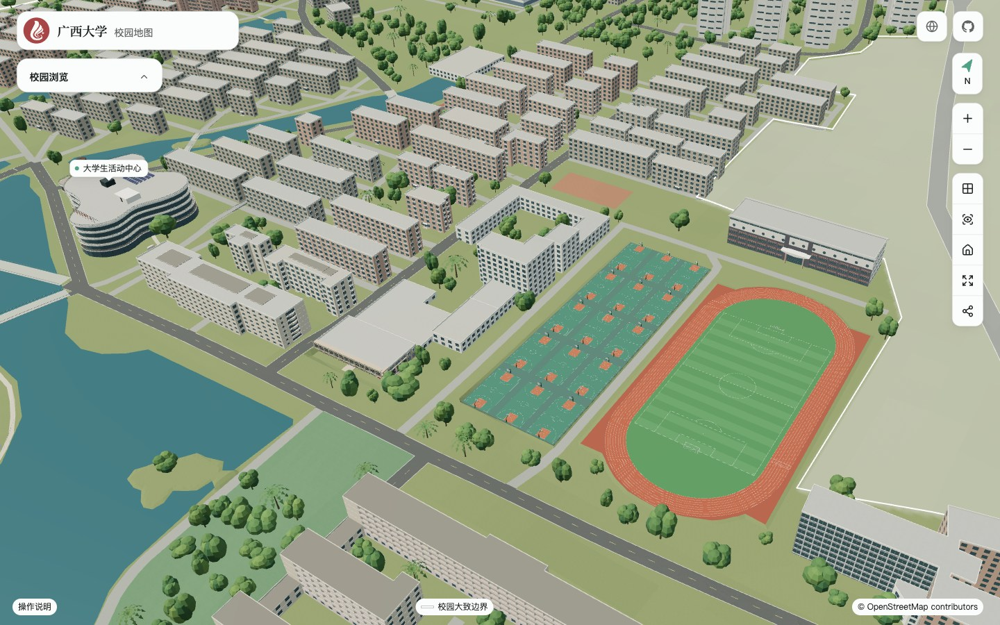

<h1 align="center">广西大学 校园地图</h1>

<p align="center"><strong>简体中文</strong> · <a href="README.en.md">English</a></p>

广西大学大学东路主校区的交互式三维地图。地理底图取自 OpenStreetMap，主要建筑与地标参考公开资料在 Blender 中建模，网页端基于 Three.js 和 React 实现。

**[在线游览](https://wcqqq1214.github.io/gxu-campus-3d/)**



## 功能

- 按中英文名称、简称或院系搜索校园地标、学院楼、食堂与宿舍，切换多角度观察视角，或开启校园游览按站浏览。
- 提供清晨、白天、黄昏、夜晚四种光照，可自由开关地图图层并调节渲染画质。
- 复制当前视角链接分享给他人，或导出带有 OpenStreetMap 署名的 PNG 截图。
- 适配鼠标、手机触屏与键盘导航，并响应系统的“减少动态效果”设置。

<details>
<summary>更多截图：光影、近景与手机界面</summary>

| 清晨 | 白天 |
| --- | --- |
|  |  |
| 黄昏 | 夜晚 |
|  |  |
| 图书馆北侧 | 崇左桥下穿通道 |
|  |  |
| 手机地点详情 | 手机工具菜单 |
|  |  |



</details>

> 截图摄于 2026-11-28，均来自本地 `dev` 静态构建，与在线站点可能略有不同。手机截图使用浏览器模拟视口。

## 本地运行

项目使用 Node.js 24（见 [.nvmrc](.nvmrc)，与 CI 保持一致；使用 nvm 时可运行 `nvm install && nvm use`）。页面为纯静态前端，无需地图 API 密钥或后端服务：

```sh
git clone --branch dev https://github.com/wcqqq1214/gxu-campus-3d.git
cd gxu-campus-3d
npm ci
npm run dev
```

启动后打开终端输出的 Local 地址即可浏览。如需打包静态站点或在本地预览构建结果：

```sh
npm run build:pages   # 构建静态文件到 out/
npm run preview       # 本地预览：http://127.0.0.1:4300/gxu-campus-3d/
```

### 检查与测试

- **前端检查**：`npm run check` 依次执行 TypeScript 类型检查、oxlint 校验和 JS/TS 单元测试；也可单独运行 `npm run typecheck:fast`（基于 tsrs 快速类型检查，CI 在 `frontend` 任务中优先执行）。
- **Python 检查与测试**：Python 版本在 [.python-version](.python-version) 中固定为 3.12。安装开发依赖后，可运行 `npm run lint:python`（Ruff 检查）、`npm run format:python`（代码格式化）和 `npm run test:data`（多进程并行数据与契约测试，支持传模块名过滤与 `TEST_DATA_WORKERS`）。
- **浏览器回归**：先运行 `npx playwright install chromium`，再执行 `npm run test:browser`，验证菜单交互、相机控制与中英文界面（本地默认并行，`SWIFTSHADER=1` 时默认串行，可用 `-- --only=menu,camera-desktop,camera-mobile,i18n` 按项单跑，需 DOM/网络 trace 时附加 `BROWSER_TRACE=1`）。

向 `dev` 分支推送代码时，CI 会按改动路径并行触发前端、Python（`npm run test:data`）、Blender 几何回归（`npm run test:geometry`）与 3 路矩阵并行的浏览器回归（并缓存 Playwright Chromium）；向 `main` 推送或提 PR 时运行全量检查，仅直接推送 `main` 时自动部署。完整环境与构建说明见[模型结构、测试与重建](docs/MODELING.md)。

## 数据与文档

模型涵盖东、西、北三个校园区域。由于未做实地测绘，部分建筑高度、外立面和场地布局依据公开资料估算。

- [数据来源与精度](docs/DATA.md)
- [模型结构、测试与重建](docs/MODELING.md)（Blender 源文件不随仓库分发，运行网页无需该文件）
- [界面与交互](docs/DESIGN.md)

项目原创代码、文档、模型、材质和渲染图采用 [MIT](LICENSE) 许可；OpenStreetMap 地理数据库及其衍生数据遵循 ODbL，署名 **© OpenStreetMap contributors**。其余资源的授权见[第三方说明](licenses/THIRD_PARTY.md)，参考照片与视频不随仓库分发。
